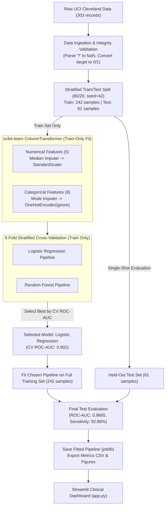

# End-to-End Machine Learning Workflow for Cardiac Health Risk Prediction

[](https://www.python.org/)
[](https://opensource.org/licenses/MIT)
[](https://streamlit.io/)
[](https://scikit-learn.org/)
[](https://pytest.org/)

An educational, clinical-grade machine learning project predicting coronary artery disease (CAD) risk from routine non-invasive clinical attributes using the benchmark **UCI Cleveland Heart Disease dataset**.

> [!IMPORTANT]
> **Mandatory Clinical Disclaimer:**
> This repository is an **educational research prototype** created for academic demonstration in Health Informatics and Analytics. It is **NOT a certified medical device (Software as a Medical Device - SaMD)**, has not undergone prospective clinical trials, and does **not** provide medical diagnoses or treatment recommendations. Always consult a licensed cardiologist or physician for clinical medical guidance.

---

## 📖 Table of Contents
1. [Project Overview & Health Informatics Problem](#-project-overview--health-informatics-problem)
2. [Dataset Provenance & Data Dictionary](#-dataset-provenance--data-dictionary)
3. [End-to-End Machine Learning Methodology](#-end-to-end-machine-learning-methodology)
4. [Project Structure](#-project-structure)
5. [Installation & Local Run Instructions](#-installation--local-run-instructions)
6. [Model Evaluation & Clinical Results](#-model-evaluation--clinical-results)
7. [Streamlit Clinical Web Dashboard](#-streamlit-clinical-web-dashboard)
8. [Automated Testing Suite](#-automated-testing-suite)
9. [Ethical Considerations, Bias & Limitations](#-ethical-considerations-bias--limitations)
10. [Step-by-Step GitHub Publishing Guide](#-step-by-step-github-publishing-guide)
11. [Streamlit Community Cloud Deployment Guide](#-streamlit-community-cloud-deployment-guide)
12. [Presentation Guide for Your Professor](#-presentation-guide-for-your-professor)

---

## 🏥 Project Overview & Health Informatics Problem

Coronary Artery Disease (CAD) remains the single largest contributor to cardiovascular mortality globally. While definitive confirmation relies on invasive coronary catheterization (revealing $\ge 50\%$ diameter stenosis), early risk stratification through non-invasive biomarkers—such as exercise treadmill electrocardiography, resting blood pressure, and symptom presentation—can optimize clinical triage and prevent unnecessary invasive procedures.

### Primary Goals
- Construct a **strictly leak-free** scikit-learn preprocessing and modeling pipeline.
- Evaluate multiple candidate architectures (regularized **Logistic Regression** vs. non-linear **Random Forest**).
- Utilize **Stratified 5-Fold Cross-Validation** on training data only, holding out an untouched 20% test partition for unbiased generalization assessment.
- Deliver an interactive, responsive **Streamlit clinical dashboard** for real-time risk simulation, probability scoring, and clinical factor explanation.

---

## 📊 Dataset Provenance & Data Dictionary

- **Source**: [UCI Machine Learning Repository: Heart Disease (Cleveland Database)](https://archive.ics.uci.edu/dataset/45/heart+disease)
- **Direct File**: `processed.cleveland.data`
- **Citation**:
  > Detrano, R., Janosi, A., Steinbrunn, W., Pfisterer, M., Schmid, J. J., Sandhu, S., ... & Froelicher, V. (1989). International application of a new probability algorithm for the diagnosis of coronary artery disease. *American Journal of Cardiology*, 64(5), 304-310.

### The 13 Clinical Predictors & Binary Target

| # | Feature Key | Clinical Name | Type | Range / Encoding |
|---|---|---|---|---|
| 1 | `age` | Patient Age | Numerical | 29 – 77 years |
| 2 | `sex` | Biological Sex | Categorical | 0 = Female, 1 = Male |
| 3 | `cp` | Chest Pain Type | Categorical | 1: Typical Angina, 2: Atypical Angina, 3: Non-Anginal, 4: Asymptomatic |
| 4 | `trestbps` | Resting Blood Pressure | Numerical | 94 – 200 mm Hg upon admission |
| 5 | `chol` | Serum Cholesterol | Numerical | 126 – 564 mg/dl |
| 6 | `fbs` | Fasting Blood Sugar > 120 | Categorical | 0 = False, 1 = True |
| 7 | `restecg` | Resting ECG Results | Categorical | 0: Normal, 1: ST-T wave abnormality, 2: LV hypertrophy |
| 8 | `thalach` | Max Heart Rate Achieved | Numerical | 71 – 202 bpm during stress testing |
| 9 | `exang` | Exercise-Induced Angina | Categorical | 0 = No, 1 = Yes |
| 10 | `oldpeak` | Exercise ST Depression | Numerical | 0.0 – 6.2 mm |
| 11 | `slope` | Peak ST Segment Slope | Categorical | 1: Upsloping, 2: Flat, 3: Downsloping |
| 12 | `ca` | Fluoroscopy Major Vessels | Discrete | 0, 1, 2, or 3 colored vessels (`?` = missing) |
| 13 | `thal` | Thallium Scintigraphy | Categorical | 3 = Normal, 6 = Fixed Defect, 7 = Reversible Defect (`?` = missing) |
| **T** | **`target`** | **Angiographic CAD Status** | **Binary Target** | **0 = Absence** ($<50\%$ stenosis), **1 = Presence** ($\ge 50\%$ stenosis) |

### Target Transformation Rule
The raw dataset coded angiographic severity as `num` ($0, 1, 2, 3, 4$). Following established clinical informatics benchmarks:
$$\text{target} = \begin{cases} 0 & \text{if } \text{num} = 0 \quad (\text{Absence of coronary artery disease}) \\ 1 & \text{if } \text{num} \ge 1 \quad (\text{Presence of coronary artery disease}) \end{cases}$$
The raw `num` column is immediately dropped to prevent target leakage.

---

## 🔬 End-to-End Machine Learning Methodology



### Preprocessing & Leakage Elimination
- **Imputation**: Median imputation for continuous variables (`age`, `trestbps`, `chol`, `thalach`, `oldpeak`); Most frequent mode imputation for categorical features (`ca`, `thal`).
- **Feature Scaling**: `StandardScaler` applied to continuous predictors to ensure numerical stability and correct gradient convergence for Logistic Regression.
- **Categorical Handling**: `OneHotEncoder(handle_unknown='ignore', sparse_output=False)` to prevent app crashes on unseen user inputs.
- **Pipeline Architecture**: All transformers and estimators are packaged within a unified `Pipeline`. Preprocessing statistics are calculated **strictly per cross-validation training fold**.

---

## 📁 Project Structure

```
cardiac-ml-workflow/
├── .gitignore                      # Git ignore file (cache, virtualenvs, checkpoints)
├── LICENSE                         # MIT License
├── README.md                       # Comprehensive project documentation & guide
├── requirements.txt                # Pinned, reproducible dependency versions
├── app.py                          # Multi-page interactive Streamlit clinical dashboard
├── run_pipeline.bat                # 1-click Windows runner for model training & evaluation
├── run_app.bat                     # 1-click Windows runner for Streamlit dashboard
├── run_tests.bat                   # 1-click Windows runner for Pytest suite
├── data/
│   ├── README.md                   # Detailed dataset provenance, dictionary & manual download fallback
│   ├── raw/
│   │   └── processed.cleveland.data# Cached raw UCI dataset
│   └── processed/
│       └── heart_cleveland_clean.csv# Cleaned dataset with binary target
├── models/
│   ├── .gitkeep
│   ├── best_cardiac_pipeline.joblib# Selected best model pipeline (Logistic Regression)
│   ├── pipeline_logistic_regression.joblib
│   ├── pipeline_random_forest.joblib
│   └── model_metadata.json         # Training metadata, random seed, feature orders, CV scores
├── reports/
│   ├── .gitkeep
│   ├── model_comparison.csv        # Comprehensive CV vs Held-Out Test metrics table
│   ├── metrics_summary.json        # Raw JSON metrics output
│   └── figures/                    # Publication-quality evaluation plots
│       ├── eda_target_distribution.png
│       ├── eda_correlation_heatmap.png
│       ├── eda_age_thalach_by_target.png
│       ├── eda_chest_pain_by_target.png
│       ├── roc_curves_comparison.png
│       ├── confusion_matrix_logistic_regression.png
│       ├── confusion_matrix_random_forest.png
│       └── feature_importance_random_forest.png
├── src/
│   ├── __init__.py
│   ├── data_loader.py              # UCI fetch, local fallback, parsing, target conversion
│   ├── preprocessing.py            # ColumnTransformer & Pipeline builder
│   ├── train.py                    # Stratified split, 5-fold CV, model selection, saving artifacts
│   ├── evaluate.py                 # Multi-metric calculation, ROC curves, confusion matrices
│   └── predict.py                  # Inference engine, schema validation, clinical risk tiering
└── tests/
    ├── __init__.py
    ├── test_data_loader.py         # Unit tests for data loading and target binarization
    ├── test_preprocessing.py        # Unit tests for imputation, scaling, and leakage prevention
    └── test_prediction.py          # Unit tests for pipeline inference, input validation, risk bounds
```

---

## 🚀 Installation & Local Run Instructions

### Step 1: Clone or Navigate to the Repository
```bash
git clone https://github.com/YOUR_USERNAME/cardiac-ml-workflow.git
cd cardiac-ml-workflow
```

### Step 2: Create and Activate a Virtual Environment
**On Windows (PowerShell):**
```powershell
python -m venv venv
.\venv\Scripts\Activate.ps1
```
*(If using Anaconda: launch Anaconda Prompt and navigate to this folder).*

### Step 3: Install Dependencies
```bash
pip install -r requirements.txt
```

### Step 4: Run the Machine Learning Training Pipeline
```bash
python src/train.py
```
*(On Windows, you can also double-click `run_pipeline.bat`)*

### Step 5: Execute the Unit Tests
```bash
pytest -v
```
*(Or double-click `run_tests.bat`)*

### Step 6: Launch the Streamlit Clinical Web Dashboard
```bash
streamlit run app.py
```
*(Or double-click `run_app.bat`)*
Open your web browser at `http://localhost:8501`.

---

## 📈 Model Evaluation & Clinical Results

### 1. Training 5-Fold Stratified Cross-Validation (Model Selection)
*Models evaluated strictly on the 80% training set (242 samples) to choose the best architecture without test set contamination:*

| Candidate Model | CV ROC-AUC (Mean ± Std) | CV Recall / Sensitivity | CV F1-Score | CV Accuracy |
|---|---|---|---|---|
| **Logistic Regression (Selected)** | **0.902 ± 0.014** | **0.783** | **0.825** | **0.847** |
| Random Forest Classifier | 0.895 ± 0.034 | 0.764 | 0.780 | 0.806 |

### 2. Final Held-Out Test Evaluation (Evaluated Once on 61 Samples)
*Evaluated on the 20% untouched held-out test partition:*

| Evaluation Metric | Logistic Regression (Selected Best) | Random Forest | Clinical Significance |
|---|---|---|---|
| **ROC-AUC** | **0.9665** | 0.9426 | Overall diagnostic discrimination across all thresholds |
| **Sensitivity (Recall)** | **92.86% (26/28)** | 85.71% (24/28) | **Critical**: Proportion of actual cardiac disease patients detected |
| **Specificity** | **84.85% (28/33)** | 84.85% (28/33) | Proportion of disease-free patients correctly identified |
| **Precision (PPV)** | **83.87%** | 82.76% | Positive predictive value of a positive screen |
| **F1-Score** | **0.8814** | 0.8421 | Harmonic mean of precision and recall |
| **Accuracy** | **88.52%** | 85.25% | Overall proportion of correct classifications |
| **Balanced Accuracy** | **88.85%** | 85.28% | Average of sensitivity and specificity |
| **False Negatives (Missed)** | **2 patients** | 4 patients | **Severe safety impact**: Undetected CAD cases |
| **False Positives** | **5 patients** | 5 patients | Over-triage requiring confirmatory assessment |

### Clinical Confusion Matrix Analysis
- **Selected Model (Logistic Regression)**: Out of 28 positive cardiac patients in the held-out test set, the model correctly identified **26 patients** and missed only **2**.
- Specificity remained strong at **84.85%**, preventing excessive unnecessary angiographic referrals.

---

## 🫀 Streamlit Clinical Web Dashboard

The Streamlit web application (`app.py`) provides a clean clinical decision-support interface:

1. **Project Overview & Clinical Scope**: Clinical rationale, architecture diagrams, and prominent medical disclaimers.
2. **Dataset Explorer & Quality Audit**: Tabular cohort inspection, missing value breakdown, and automated integrity checks.
3. **Exploratory Data Analysis (EDA)**: Interactive distribution plots, correlation heatmaps, and clinical domain explanations.
4. **Model Benchmark & Evaluation**: Side-by-side metric tables, interactive ROC curves, and confusion matrices.
5. **Patient Risk Assessment Form**:
   - Interactive clinical inputs for all 13 predictors (age, blood pressure, chest pain type, ST depression, fluoroscopy vessels, thallium scintigraphy).
   - One-click presets for Low-Risk, Intermediate-Risk, and High-Risk clinical patient profiles.
   - Outputs: Model probability ($p$), color-coded Risk Tier (Low, Moderate, High), and plain-English contributing clinical risk factors.
6. **Clinical Ethics & Limitations**: In-depth analysis of demographic representation, algorithmic bias, and FDA SaMD regulatory boundaries.

---

## 🧪 Automated Testing Suite

The repository includes a comprehensive `pytest` test suite:
- `tests/test_data_loader.py`:
  - `test_load_heart_disease_data_schema`: Verifies 303 rows and 14 expected columns.
  - `test_binary_target_conversion`: Verifies binary target conversion (164 negative vs 139 positive).
  - `test_no_target_leakage_in_features`: Confirms target and raw `num` are absent from feature matrix `X`.
  - `test_missing_values_parsed_as_nan`: Verifies that `?` symbols are parsed into IEEE NaNs in `ca` and `thal`.
- `tests/test_preprocessing.py`:
  - `test_create_preprocessor_structure`: Confirms `ColumnTransformer` composition.
  - `test_imputation_and_scaling`: Confirms zero NaNs remain post-imputation and scaling.
  - `test_no_data_leakage_between_train_and_test`: Mathematically proves test data transforms do not mutate train mean/variance.
  - `test_build_pipeline`: Confirms complete two-step Pipeline execution.
- `tests/test_prediction.py`:
  - `test_validate_input_dict_valid`: Confirms valid patient dictionary formats correctly.
  - `test_validate_input_dict_missing_key`: Validates error handling on missing clinical fields.
  - `test_validate_input_dict_out_of_bounds`: Catches physiologically impossible values.
  - `test_validate_input_dict_invalid_thal`: Catches invalid categorical codes.
  - `test_predictor_inference_and_probabilities`: Confirms probability output bounds $[0, 1]$ and valid risk tiering.

Run all tests:
```bash
pytest -v
```

---

## ⚖️ Ethical Considerations, Bias & Limitations

1. **Demographic Representation**:
   - The Cleveland cohort contains only **32% female patients** (97 females vs 206 males). Ischemia often manifests differently in female patients (e.g., non-obstructive coronary disease), which may bias model sensitivity.
2. **Temporal & Geographic Relevance**:
   - Collected in 1988 at a single medical center. Diagnostic protocols, baseline pharmacological therapy (statins), and high-sensitivity troponin assays have advanced significantly since this data was compiled.
3. **Clinical Cost Matrix (FP vs FN)**:
   - A **False Negative** leaves an ischemic patient at risk of unmonitored acute myocardial infarction.
   - A **False Positive** causes patient anxiety and costs associated with confirmatory testing.
   - Our workflow deliberately optimizes for Sensitivity/Recall to protect patient safety.
4. **Data Privacy**:
   - No patient input data entered into the Streamlit app is logged, persisted to disk, or transmitted to third-party endpoints.

---

## 🌐 Step-by-Step GitHub Publishing Guide

To publish your project to GitHub for your professor and classmates to review:

### Step 1: Initialize Git in your project folder
Open PowerShell in `c:\Users\HAMEDA\OneDrive\Desktop\cardiac-ml-workflow`:
```powershell
git init
```

### Step 2: Configure your Git Identity (if not already set)
```powershell
git config user.name "Your Name"
git config user.email "your.email@university.edu"
```

### Step 3: Stage and Commit All Files
```powershell
git add .
git commit -m "feat: complete end-to-end cardiac ML workflow, evaluation reports, and streamlit app"
```

### Step 4: Create a New Empty Repository on GitHub
1. Go to [github.com/new](https://github.com/new).
2. Repository name: `cardiac-ml-workflow`
3. Description: `End-to-End Machine Learning Workflow for Cardiac Health Risk Prediction`
4. Set visibility to **Public**.
5. **Do NOT check** "Add a README", ".gitignore", or "license" (we have already created them locally).
6. Click **Create repository**.

### Step 5: Link Local Repo to GitHub & Push
```powershell
git branch -M main
git remote add origin https://github.com/YOUR_GITHUB_USERNAME/cardiac-ml-workflow.git
git push -u origin main
```
*(Git will prompt you to authenticate via your browser or a Personal Access Token).*

---

## ☁️ Streamlit Community Cloud Deployment Guide

To deploy a live, shareable URL for your professor:

1. Push your repository to GitHub (following the steps above).
2. Visit [share.streamlit.io](https://share.streamlit.io/) and sign in with your GitHub account.
3. Click **"New app"**.
4. Select your repository: `YOUR_GITHUB_USERNAME/cardiac-ml-workflow`.
5. Set branch: `main`.
6. Set Main file path: `app.py`.
7. Click **"Deploy!"**.
8. Within 2-3 minutes, your live web dashboard will be accessible at:
   `https://cardiac-ml-workflow-YOUR_APP_ID.streamlit.app`

---

## 🎓 Presentation Guide for Your Professor

When explaining your assignment to your professor, highlight these key design choices:

1. **Why Cleveland Heart Disease?**
   - It is the standard reference dataset in cardiovascular informatics, with well-documented angiographic stenosis ground truth.
2. **How did you prevent Data Leakage?**
   - Explain that you performed the stratified train/test split **before** any imputer or scaler was fitted.
   - Emphasize that `ColumnTransformer` is nested inside a `Pipeline`, ensuring that in every cross-validation fold, preprocessing statistics (mean, median) are computed solely from the training folds.
3. **Why did Logistic Regression outperform Random Forest?**
   - For smaller tabular clinical datasets ($N=303$) with moderate feature dimensionality ($D=13$), regularized linear models often achieve higher test-set generalizability with lower variance than complex decision tree ensembles.
4. **Why prioritize Recall / Sensitivity over Accuracy?**
   - In clinical screening, missing a patient with actual heart disease (False Negative) is a catastrophic failure. Our selected model caught **26 out of 28** cardiac cases (92.86% sensitivity) with only 2 false negatives.
5. **Why include the Ethical & Limitations section?**
   - Health informatics professionals must understand dataset biases (e.g., 32% female representation in 1988 data) and regulatory constraints (FDA SaMD guidelines) before considering ML in clinical workflows.
